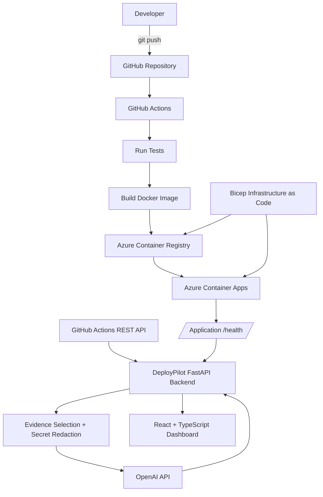

# DeployPilot

**AI-assisted CI/CD observability and deployment troubleshooting from GitHub to Azure.**

> DeployPilot helps developers deploy a small application from GitHub to Azure and understand what went wrong when the software delivery process fails.

DeployPilot demonstrates an end-to-end cloud delivery workflow using GitHub Actions, Docker, Azure Container Registry, Azure Container Apps, Bicep, FastAPI, React/TypeScript, and the OpenAI API.

It monitors both the **delivery pipeline** and the **running application**, collects real failure evidence, redacts sensitive values, and converts that evidence into a structured developer-friendly diagnosis.

<!-- Step 14C: add primary dashboard screenshot here.

-->

---

## What DeployPilot Does

A developer pushes code to GitHub.

DeployPilot's delivery pipeline then:

1. runs automated tests;
2. builds a Docker image;
3. pushes the image to Azure Container Registry;
4. deploys the image to Azure Container Apps;
5. checks the health of the running application.

DeployPilot observes the process through five stages:

```text
Build → Tests → Container → Deployment → Runtime
```

If a stage fails, DeployPilot collects the relevant evidence and presents:

- the failed stage;
- the detected problem;
- the likely cause;
- a suggested fix;
- the underlying evidence used for the diagnosis.

The AI does **not** decide whether a deployment succeeded.

> **Detection is deterministic. Interpretation is AI-assisted.**

GitHub Actions and application health checks determine actual system state. AI is used only to interpret selected evidence.

---

## Architecture



### Delivery path

```text
GitHub
   ↓
GitHub Actions
   ↓
Tests
   ↓
Docker build
   ↓
Azure Container Registry
   ↓
Azure Container Apps
   ↓
Runtime health check
```

### Failure-analysis path

```text
GitHub / Runtime failure
          ↓
Relevant evidence collected
          ↓
Secret redaction
          ↓
Normalized FailureEvidence
          ↓
OpenAI structured analysis
          ↓
DeployPilot dashboard
```

---

## Technology Stack

| Area | Technology |
|---|---|
| Frontend | React, TypeScript, Vite |
| Backend | Python, FastAPI |
| Demo workload | Python, FastAPI |
| Testing | pytest |
| Containers | Docker |
| CI/CD | GitHub Actions |
| Cloud | Microsoft Azure |
| Container registry | Azure Container Registry |
| Runtime | Azure Container Apps |
| Infrastructure as Code | Bicep |
| Azure authentication | GitHub OIDC + Managed Identities |
| Failure analysis | OpenAI API |
| Source control | Git / GitHub |

---

## Dashboard

DeployPilot presents the latest workflow and runtime state in one view.

The dashboard includes:

- application and environment;
- Git branch;
- commit SHA;
- GitHub Actions workflow run;
- build status;
- test status;
- container status;
- deployment status;
- runtime health;
- AI-assisted failure diagnosis;
- expandable raw failure evidence.

A successful deployment appears as:

```text
Build          ✓ Passed
Tests          ✓ Passed
Container      ✓ Passed
Deployment     ✓ Passed
Runtime        ✓ Passed
```

A key design choice is that **Deployment** and **Runtime** are separate.

For example:

```text
Build          ✓ Passed
Tests          ✓ Passed
Container      ✓ Passed
Deployment     ✓ Passed
Runtime        ✕ Failed
```

This represents a deployment that technically succeeded while the running application is unhealthy.

---

## Demonstrated Failure Scenarios

The MVP was validated using three deliberate scenarios.

### 1. Successful deployment

A normal push to `main` results in:

```text
Tests → Docker build → ACR → Azure Container Apps → /health
  ✓           ✓         ✓             ✓               ✓
```

DeployPilot reports all five stages as healthy.

<!-- Step 14C:

-->

### 2. CI / unit-test failure

A unit test was deliberately changed to expect the wrong API response.

GitHub Actions stopped at the test stage and skipped deployment.

DeployPilot then:

1. detected the failed GitHub Actions step;
2. retrieved the associated job logs;
3. selected the relevant pytest output;
4. redacted sensitive information;
5. sent the selected evidence for AI analysis;
6. displayed the problem, likely cause, and suggested fix.

The previously deployed Azure application remained healthy because the failed commit never reached deployment.

<!-- Step 14C:

-->

### 3. Runtime configuration failure

A real Azure runtime failure was created by requiring the environment variable:

```text
DEMO_CONFIG
```

without supplying it.

The CI/CD pipeline remained green:

```text
Build          ✓
Tests          ✓
Container      ✓
Deployment     ✓
```

but the deployed application's `/health` endpoint returned:

```text
HTTP 500
```

DeployPilot therefore reported:

```text
Runtime        ✕ Failed
```

The health response identified the missing configuration, and the AI assistant correctly explained the problem and suggested the required configuration fix.

This demonstrates why runtime health must be observed separately from deployment status.

---

## Failure Evidence

DeployPilot normalizes failures into a common structure before asking AI to interpret them.

Example fields include:

```text
stage
error_message
logs
exit_code
health_status
http_status
```

Pipeline failures use selected GitHub Actions job-log excerpts.

Runtime failures use the actual application health response and HTTP status.

The entire repository is **not** sent to the model.

Only the evidence needed to understand the failure is selected.

---

## Security Design

Several security decisions are deliberately built into the project.

### GitHub → Azure authentication

GitHub Actions authenticates to Azure through **OpenID Connect (OIDC)** and a managed identity.

This avoids storing a long-lived Azure client secret in GitHub.

### Managed identities

Separate Azure identities are used for different responsibilities.

The running Container App receives only the permissions required to pull its image from Azure Container Registry.

The GitHub deployment identity receives the permissions required for the deployment workflow.

### Server-side secrets

Credentials such as:

```text
GITHUB_TOKEN
OPENAI_API_KEY
```

are backend-only environment variables.

They are never placed in the React frontend.

Real `.env` files are ignored by Git. A safe `.env.example` documents required configuration using placeholders.

### Evidence redaction

Failure evidence passes through deterministic redaction rules before being displayed or sent to the OpenAI API.

Examples of values detected and removed include:

```text
GitHub token patterns
OpenAI-style API keys
Authorization headers
password / secret assignments
sensitive URL query parameters
```

Sensitive values are replaced with:

```text
[REDACTED]
```

### Minimum-context AI

The model receives selected troubleshooting evidence rather than:

- the entire repository;
- complete environment-variable dumps;
- arbitrary credentials;
- unnecessary source code.

---

## Reliability and Engineering Safeguards

The final engineering pass added:

- explicit GitHub and runtime HTTP timeouts;
- health-check connection and timeout handling;
- bounded runtime error payloads;
- limited GitHub log excerpts;
- consistent API error responses;
- structured JSON backend logging;
- stale-analysis protection in the frontend;
- deterministic secret redaction;
- server-side AI integration;
- tests using mocked external systems;
- TypeScript production-build verification.

Automated tests do not require real GitHub, Azure, or OpenAI API calls.

---

## Repository Structure

```text
DeployPilot/
│
├── .github/
│   └── workflows/
│       └── ci.yml
│
├── backend/
│   ├── app/
│   │   ├── main.py
│   │   ├── routes.py
│   │   ├── models.py
│   │   ├── github_client.py
│   │   ├── health_client.py
│   │   ├── ai_client.py
│   │   ├── redaction.py
│   │   ├── errors.py
│   │   └── logging_config.py
│   ├── tests/
│   ├── requirements.txt
│   └── .env.example
│
├── demo-app/
│   ├── app/
│   ├── tests/
│   ├── Dockerfile
│   └── requirements.txt
│
├── frontend/
│   ├── src/
│   └── package.json
│
├── infra/
│   ├── app.bicep
│   ├── foundation.bicep
│   ├── *.bicepparam
│   └── modules/
│
├── docs/
│   ├── ARCHITECTURE.md
│   ├── DECISIONS.md
│   ├── PROJECT_CONTEXT.md
│   └── ROADMAP.md
│
└── README.md
```

---

## Local Development

### Requirements

Recommended local tools:

- Python 3.12+
- Node.js / npm
- Git
- Docker
- Azure CLI
- Bicep CLI support

### Backend

From:

```text
backend/
```

create and activate a virtual environment:

```cmd
python -m venv .venv
.venv\Scripts\activate
```

Install dependencies:

```cmd
python -m pip install -r requirements.txt
```

The backend uses environment variables documented in:

```text
backend/.env.example
```

For Windows Command Prompt, they can be configured locally using:

```cmd
set GITHUB_OWNER=your-github-owner
set GITHUB_TOKEN=your-github-token
set OPENAI_API_KEY=your-openai-api-key
set OPENAI_MODEL=your-model
set DEMO_APP_BASE_URL=https://your-app.azurecontainerapps.io
```

Then run:

```cmd
uvicorn app.main:app --reload
```

Backend:

```text
http://127.0.0.1:8000
```

### Frontend

From:

```text
frontend/
```

install dependencies:

```cmd
npm install
```

Start the development server:

```cmd
npm run dev
```

Frontend:

```text
http://localhost:5173
```

---

## Testing

### Backend

```cmd
cd backend
python -m pytest -v
```

External services are mocked during automated tests, so running the test suite does not require consuming OpenAI API credits or contacting the production Azure application.

### Frontend production build

```cmd
cd frontend
npm run build
```

---

## Infrastructure as Code

Azure infrastructure is defined with **Bicep**.

The infrastructure includes:

- Azure Container Registry;
- Azure Container Apps Environment;
- Azure Container App;
- managed identities;
- required RBAC assignments;
- GitHub OIDC federation configuration.

Generated ARM JSON output is not committed to the repository; Bicep remains the source of truth.

---

## CI/CD

The GitHub Actions workflow performs the deployment path automatically.

For pushes to `main`:

```text
Run tests
   ↓
Build Docker image
   ↓
Authenticate to Azure using OIDC
   ↓
Push image to ACR
   ↓
Deploy exact commit image to Azure Container Apps
```

Images are tagged using the Git commit SHA, providing traceability between a workflow run and the deployed container image.

---

## API Examples

Main DeployPilot endpoints include:

```text
GET  /health
GET  /api/deployment
GET  /api/github/latest-run

GET  /api/failure-evidence/{run_id}
POST /api/failure-report/{run_id}

GET  /api/runtime-health
GET  /api/runtime-failure-evidence
POST /api/runtime-failure-report

POST /api/analyze
```

---

## MVP Scope

DeployPilot intentionally remains a focused portfolio MVP.

Version 1 supports:

- one application;
- one GitHub repository;
- one Azure deployment environment;
- latest deployment state;
- CI/CD failure analysis;
- runtime-health analysis;
- advisory AI troubleshooting.

DeployPilot does **not** automatically modify code, change infrastructure, alter secrets, or redeploy an application.

The AI remains advisory rather than autonomous.

---

## Future Improvements

Potential future versions could add:

- GitHub OAuth or GitHub App integration;
- arbitrary repository onboarding;
- deployment-history persistence;
- multiple applications;
- staging and production environments;
- rollback workflows;
- Azure Monitor / Application Insights;
- richer deployment telemetry;
- automated pull-request fix suggestions;
- controlled remediation workflows;
- Kubernetes / AKS support;
- additional cloud providers.

These are intentionally deferred so the MVP remains focused on one complete, explainable delivery and troubleshooting workflow.

---

## Key Engineering Principle

DeployPilot's main architectural principle is:

> **Detection is deterministic. Interpretation is AI-assisted.**

Tests, GitHub Actions, Azure, HTTP responses, and health checks establish what happened.

AI helps the developer understand **why it happened and what to do next**.